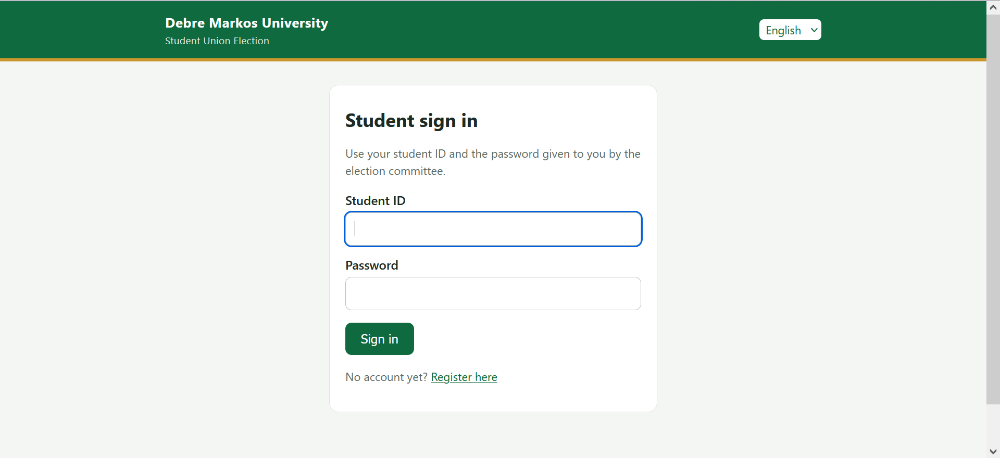

# DMU Student Union Online Voting System

A web-based election management and online voting system developed for **Debre Markos University (DMU)** using Python and Django. The platform helps administrators manage elections, positions, candidates, and voter eligibility while allowing approved students to participate in scheduled elections.

**Live Demo:** [DMU Election System](https://tilahun1921.pythonanywhere.com)

> **Project status:** Deployed on PythonAnywhere. This is an academic software project; independent security review is required before use in a high-stakes election.

## Screenshots

### Student Login Page



## Key Features

- **Student registration:** Collect student information for election participation.
- **Administrator approval:** Review and approve student accounts where required.
- **Authentication:** Require users to sign in before accessing protected voting features.
- **Election management:** Configure elections, positions, candidates, and voting schedules.
- **Voting safeguards:** Apply application-level checks and database constraints to help prevent duplicate votes.
- **Ballot privacy design:** Separate vote records from voter identity records.
- **Candidate profiles:** Display candidate photos.
- **Election scheduling:** Restrict voting according to configured start and end times.
- **Results management:** Control when election results are published.
- **Bilingual interface:** Support English and Amharic on supported student pages.
- **RFID field support:** Include an RFID field in student registration.
- **Automated tests:** Run the voting application's Django tests.

## Technology Stack

- **Backend:** Python, Django
- **Database:** SQLite
- **Frontend:** HTML, CSS, Django templates
- **Image handling:** Pillow
- **Deployment:** PythonAnywhere
- **Version control:** Git and GitHub

## Getting Started

### Prerequisites

Install a supported Python version and Git before starting.

### 1. Clone the repository

```bash
git clone https://github.com/tilahungetie14-bot/DMU-Election-System.git
cd DMU-Election-System
```

### 2. Create and activate a virtual environment

Create the environment:

```bash
python -m venv .venv
```

On Windows (Git Bash):

```bash
source .venv/Scripts/activate
```

On Windows (Command Prompt):

```cmd
.venv\Scripts\activate
```

On Linux or macOS:

```bash
source .venv/bin/activate
```

### 3. Install dependencies

```bash
python -m pip install --upgrade pip
pip install -r requirements.txt
```

### 4. Configure environment variables

Before production deployment, configure the secret key, allowed hosts, and other required settings according to `config/settings.py` and `DEPLOY.md`.

Never commit real secret keys, passwords, production databases, or private voter information to GitHub.

### 5. Prepare the database

For a new local development database:

```bash
python manage.py migrate
```

### 6. Create an administrator account

```bash
python manage.py createsuperuser
```

### 7. Optional: Create demo data

If the demo-data command is available in your checkout:

```bash
python manage.py seed_demo
```

Use demo accounts only for local testing. Never use demo credentials in production.

### 8. Start the development server

```bash
python manage.py runserver
```

Open the application at [http://127.0.0.1:8000/](http://127.0.0.1:8000/).

The Django administration panel is available at [http://127.0.0.1:8000/admin/](http://127.0.0.1:8000/admin/).

## Running an Election

1. Create an administrator account.
2. Open `/admin/` and configure an election, its positions, and candidates.
3. Register eligible students or import voter records using the project's supported management command.
4. Approve student accounts where required.
5. Configure the election schedule and publish the election according to the application's workflow.
6. Allow eligible students to vote during the permitted election period.
7. After voting closes, publish results when appropriate.

Refer to `DEPLOY.md` for deployment and voter-import instructions.

## Vote Protection and Privacy

The project includes safeguards intended to support election integrity:

- Authentication for protected voting features.
- Database constraints intended to prevent duplicate votes for a position.
- Transaction-based vote submission.
- Candidate and position validation.
- Start-time and end-time checks for voting.
- An abstain option for each position.
- Separation of ballot records from voter identity records.

These are application safeguards, not a certification of election security or ballot anonymity. A real election requires independent security testing, access-control review, backup and recovery procedures, and privacy assessment.

## Running Tests

Run the voting application's tests with:

```bash
python manage.py test voting
```

## Deployment

The production site is hosted on PythonAnywhere:

- **Website:** https://tilahun1921.pythonanywhere.com
- **Deployment guide:** [`DEPLOY.md`](DEPLOY.md)

Production deployments should use `DEBUG=False`, a strong secret key stored outside source control, correctly configured allowed hosts, HTTPS, secure access controls, and a tested backup and recovery plan.

## Project Structure

```text
DMU-Election-System/
├── config/
├── locale/
├── media/
├── screenshots/
│   └── login-page.png
├── templates/
├── voting/
├── manage.py
├── requirements.txt
├── README.md
├── DEPLOY.md
└── .gitignore
```

## Project Purpose

This project demonstrates the design and implementation of a university election web application, focusing on election administration, voter eligibility, scheduled voting, ballot privacy design, and results management.

## Author and Institution

Developed as a university software project for **Debre Markos University (DMU)**.

## License

No license has been specified yet. Contact the repository owner before reusing or redistributing this project.
